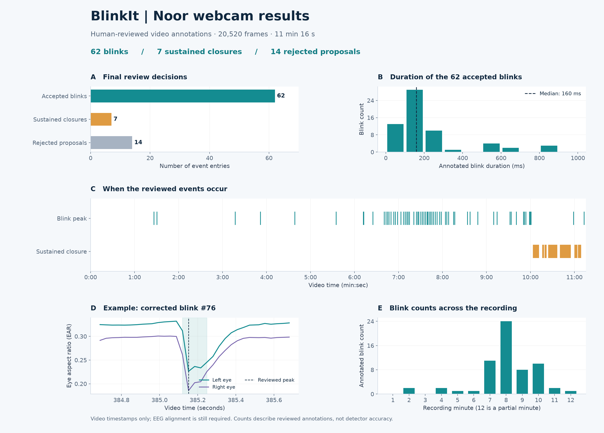

# Blinking_Detection_Blinkit
Real-time eye-blink detection from single-channel BITalino EEG, trained using webcam-labeled blinks as ground truth.

## How it works
1. SENSE    - BITalino EEG (3 electrodes, 1 channel) + webcam recorded together
2. PROCESS  - Video blinks are detected and checked, then used to label the
              EEG; a model learns the blink pattern from the labeled signal
3. SHOW     - Live EEG with detected blinks marked

## Hardware
- BITalino (EEG, 3 electrodes, 1 channel)
- Webcam (training/labeling only)
- GCO308 usb-plug camera (training/labeling only)

## Repository structure

project/
├── data/
│   ├── raw/                      
│   │   └── 25-10-2026/
│   │       ├── eeg_opensignals.txt
│   │       ├── eeg.csv          
│   │       ├── webcam.mp4
│   │       ├── webcam_timestamps.csv
│   │       ├── eyecam.mp4
│   │       ├── eyecam_timestamps.csv
│   │       └── meta.json          
│   └── derived/
│       └── 
├── models/                        
├── reports/                       
└── src/
    ├── recording_code/ 

## Installation

## Team
Rana Ezzeddine
Rahma Bezzaouia
Noor Khadra
Katrina Issa

## Webcam labeling (Rana)

See [the webcam workflow](src/webcam/README.md) for extraction, candidate generation,
manual review, timing limitations, and the handoff to EEG modeling.

## Reviewed webcam results

| Recording | Accepted blinks | Accepted sustained closures | Labels |
| --- | ---: | ---: | --- |
| Noor 1 | 62 | 7 | [session1/labels.csv](data/derived/noor/session1/labels.csv) |
| Noor 2 | 81 | 9 | [session2/labels.csv](data/derived/noor/session2/labels.csv) |
| Noor 3 | 86 | 15 | [session3/labels.csv](data/derived/noor/session3/labels.csv) |

Each CSV contains accepted visual annotations with onset, peak, and offset in source video playback seconds and corresponding zero-based frame indices.

The figure shows the original Noor 1 pilot. To generate an updated figure, run
`python reports/plot_webcam_results.py` with NumPy, Matplotlib, and the
local `webcam_ear.csv` measurements.

The [model data guide](data/model/README.md) documents the cleaned event tables, EEG tensors, and commands to rebuild them.
