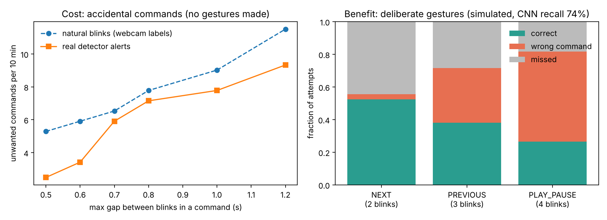

# Can BlinkIT control music? (Rahma Bezzaouia)

Gesture map: **2 blinks = next, 3 blinks = previous, 4 blinks = play/pause**.
The maximum gap between blinks in a command is 0.8 s. Reproduce these numbers with
`python3 src/blink_control/evaluate_gestures.py`.

## 1. Accidental commands while blinking normally (no gesture made)

| Session | Natural blinks, webcam labels (perfect detector) | Real detector alerts (held-out) |
|---|---:|---:|
| Noor 1 | 1.8 per 10 min | 3.6 per 10 min |
| Noor 2 | 10.6 per 10 min | 9.6 per 10 min |
| Noor 3 | 11.1 per 10 min | 8.3 per 10 min |

Natural blinks sometimes come in quick pairs. Even a perfect detector would
therefore issue some unwanted commands. Noor 2 and 3 contain far more close
pairs than Noor 1 (20 and 16 gaps under 0.8 s, against 2). The labels do not
mark voluntary blinks, so if those sessions included a voluntary-blink section,
their rates overestimate everyday use. Shorter gaps reduce accidental commands
(left panel), but they also make gestures harder to perform.

The detector alerts come from the boosted model in `reports/blink_accuracy`.
The newer CNN has no per-alert file in the repo.

## 2. Deliberate gestures (simulated from measured recall)

Detector: CNN Rana + Noor 2 replay, 74% recall, 4 false alerts per minute.

| Gesture | Correct | Wrong command | Missed |
|---|---:|---:|---:|
| NEXT (2 blinks) | 53% | 3% | 44% |
| PREVIOUS (3 blinks) | 38% | 34% | 28% |
| PLAY/PAUSE (4 blinks) | 26% | 55% | 18% |

**Main finding.** Every missed blink changes the count. A 3-blink or 4-blink
command therefore often becomes a *different* command. A wrong command is worse
than a missed one. With today's recall, only the 2-blink gesture is usable.

**Latency.** From the last blink to the command: 0.8 s (waiting for the burst to
end) + about 0.95 s detector delay. That is about 1.75 s, before Bluetooth and
audio delay.

## 3. Proposal

1. For the demo, use **one command**: 2 blinks = next song. Show the other
   gestures as future work, with the numbers above.
2. **Gate on blink strength.** Deliberate blinks are stronger than spontaneous
   ones. Count a blink toward a command only if its CNN score or EEG dip passes a
   higher threshold. The team's precision-oriented operating point had 78–80%
   precision. This should cut accidental commands, and recall on forceful blinks
   can be measured.
3. **Measure, don't simulate.** Run `music_control.py --trial 30` live with the
   BITalino on a new session. It reports correct, wrong and missed results per
   gesture, and unprompted commands per 10 min. The simulation assumes
   deliberate blinks are detected as often as natural ones, which is probably
   pessimistic.
4. **Record a voluntary-blink session.** The acquisition protocol already has a
   "Voluntary blinks" section. Label it, so a model can learn the difference
   between a deliberate blink and a natural one.
5. **Give feedback and allow undo.** Play a short tone when a command fires, and
   make a 2-blink burst within 3 s mean "undo" so mistakes can be reversed.

## Caveats

- Natural-blink rates come from one person (Noor, about 32 min).
- Gesture outcomes are simulated. Real success must be measured with `--trial`.
- The controller has been tested with keyboard input and replayed alert files
  (unit tests and a headless run). Live BITalino use still needs an on-device
  check.
