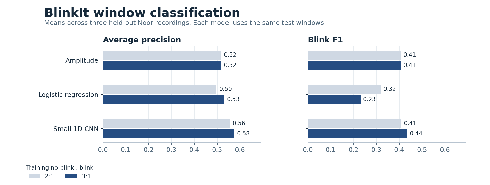
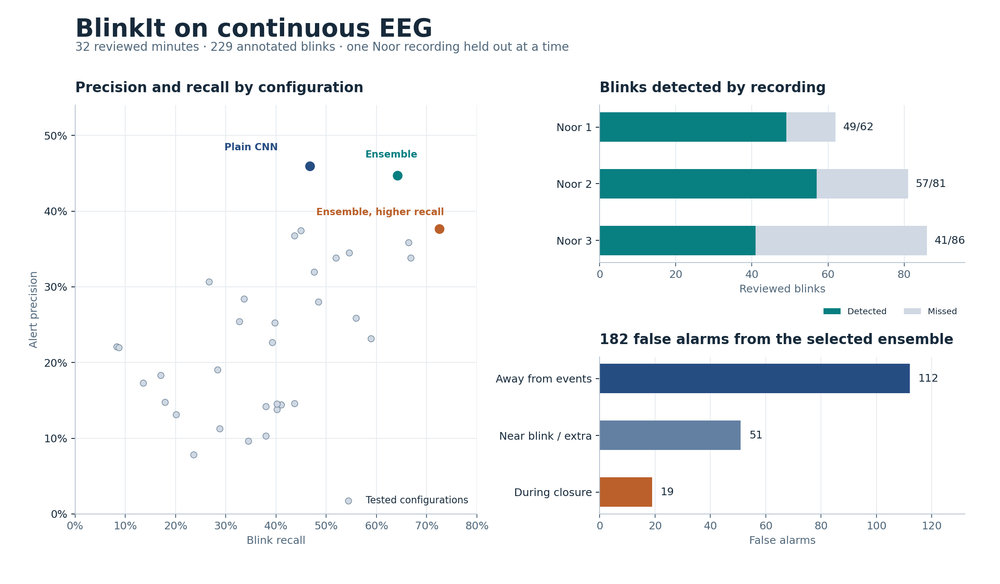

# BlinkIt training experiments

These runs use the single-channel BlinkIt EEG recordings from Noor 1–3.
The evaluation holds out one recording at a time. All three recordings
belong to the same person. Each published experiment uses the supplied EEG
event annotations and reviewed coverage. Rahma's recording and external
datasets were outside these experiments.

## 1. Classifying prepared EEG windows

The starting dataset contains 1,312 open-eye windows, 90 blink windows and
13 sustained-closure windows. The pilot compares an amplitude threshold,
waveform-feature logistic regression, and a 1,297-parameter 1D CNN. The
training sets use either two or three no-blink windows per blink. Test sets
retain available examples, with sustained closures scored separately.



The CNN led the window benchmark with **0.576 average precision** and
**0.435 F1** at 3:1. However, it caught only 0–1 of Noor 3's eight blink
windows across three seeds. The preselected, event-centered windows were
useful for an initial comparison. Continuous recordings show how often
the models fire during ordinary background.

[Window protocol and results](../blink_training/README.md) ·
[3:1 splits](../blink_training/splits.json) ·
[3:1 metrics](../blink_training/metrics.json) ·
[2:1 splits](../blink_training/ratio2/splits.json) ·
[2:1 metrics](../blink_training/ratio2/metrics.json)

## 2. Detecting events in continuous EEG

The second benchmark scans **32 reviewed minutes containing 229 labeled
blinks**. Each test recording stays out of model fitting and threshold
selection. All reviewed blinks count toward recall. Each alert can match
one event. Missed blinks remain in the denominator when the signal quality
gate abstains.

| Experiment | Comparison | Results and observations |
| --- | --- | --- |
| [10% clipping gate](../blink_continuous/clip10/metrics.json) | Amplitude, adaptive amplitude, waveform SVM and three CNN variants | The normalized, polarity-augmented CNN reached 30.7% precision and 26.6% recall at its precision operating point. |
| [25% clipping gate](../blink_continuous/clip25/metrics.json) | Repeat those six models with a more permissive signal gate | This admitted 66 positive training windows on Noor 3, up from 18. The plain CNN still missed all 86 Noor 3 blinks at its precision operating point. |
| [Hard-negative sampling](../blink_continuous/hard10/metrics.json) | Train the normalized CNN on more difficult open-eye windows | At the 10% gate, recall increased to 33.6% and precision fell to 28.4% relative to the same model without hard-negative sampling. |
| [EEG peak localization](../blink_continuous/localized25/metrics.json) | Timestamp alerts at a nearby EEG deflection | The localized plain CNN achieved the highest pooled precision, 45.9%, and caught only one Noor 3 blink. |
| [Localized SVM and CNN ensemble](../blink_continuous/localized_hybrid25/metrics.json) | Compare the waveform SVM with a geometric mean of SVM and normalized CNN scores | The ensemble had the best F1 and F0.5 among the tested settings and detected blinks in every recording. |



| Operating point | Alert precision | Blink recall | F1 | False alarms/min |
| --- | ---: | ---: | ---: | ---: |
| Localized plain CNN, precision-oriented | **45.9%** | 46.7% | 0.463 | **3.92** |
| **Selected ensemble, precision-oriented** | **44.7%** | **64.2%** | **0.527** | **5.66** |
| Same ensemble, higher recall | 37.6% | **72.5%** | 0.496 | 8.55 |

The selected ensemble caught **49/62**, **57/81**, and **41/86** blinks on Noor
1, 2, and 3, respectively. The precision-oriented setting trades just over
one percentage point of precision for 40 more detected blinks compared with
the plain CNN. This is the development candidate and remains to be evaluated
on another person.

[Continuous protocol and commands](../blink_continuous/README.md) ·
[All 34 pooled model and operating-point results](continuous_summary.csv) ·
[Selected ensemble's per-recording false alarms](false_alarm_breakdown.csv) ·
[Saved ensemble configuration](../blink_continuous/candidates/svm_cnn_ensemble/detector.json)

## 3. Reflections and next experiments

- **False alarms dominate.** Of the ensemble's 182 false alarms, 112 were
  away from labeled events, 51 were near a real blink or repeated an alert,
  and 19 fell inside a sustained closure. Review representative open-eye
  false alarms against the original video before using them as targeted
  negatives. The current audit measures timing relationships and leaves
  the underlying cause of the 112 alerts open.
- **Noor 3 remains the hardest recording.** The ensemble missed 45 of its
  86 blinks. Stronger background activity and clipping make signal quality
  and session transfer important alongside model architecture.
- **The next independent test is Rahma.** Evaluate the frozen candidate on
  Rahma when reliable EEG annotations are available. Any public-data
  pretraining comparison should use identical held-out recordings and
  compare false alarms per minute at similar recall. This study does not
  yet measure new-person performance or real-time detection latency.

## Reproduce the figures

From the repository root, with NumPy and Matplotlib installed:

```sh
python3 reports/plot_blink_experiments.py
```

The plotting script reads the saved metrics and regenerates both figures and
both summary CSVs. Each run folder contains the detailed prediction records.
