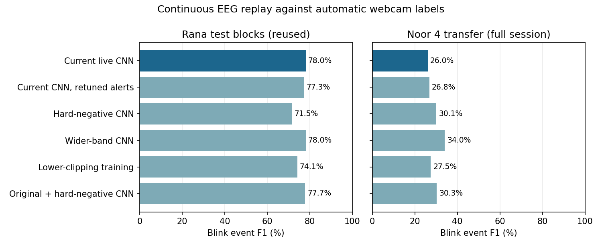

# Live blink detector experiments on existing recordings

No new recordings were collected. Rana 01 and Rana 02 supply training, validation, and held-out test blocks with the original 60/20/20 minute split. Noor 4 is evaluated as a separate transfer recording with Rana-trained models. The deployed checkpoints and app are unchanged.

## Results

All six fits completed. The threshold and policy search compared 875 settings on Rana validation. These are results on the same 158 automatic blink references in the Rana test blocks.

| Setting | Matched blinks | Unmatched alerts | Precision | Recall | Event F1 | Unmatched alerts/min |
|---|---:|---:|---:|---:|---:|---:|
| Current live CNN | 112 | 17 | 86.8% | 70.9% | 78.0% | 4.88 |
| Current CNN with 10% saturation gate | 107 | 12 | 89.9% | 67.7% | 77.3% | 3.44 |
| Hard-negative training | 93 | 9 | 91.2% | 58.9% | 71.5% | 2.58 |
| Wider-band training (validation F1 winner) | 110 | 14 | 88.7% | 69.6% | 78.0% | 4.02 |
| Training without highly clipped windows | 100 | 12 | 89.3% | 63.3% | 74.1% | 3.44 |
| Original plus hard-negative CNN (validation false-alert budget winner) | 110 | 13 | 89.4% | 69.6% | 78.3% | 3.73 |

- The blended model had the most favorable observed trade-off for Rana. At the setting selected under the original validation false-alert budget, it produced four fewer unmatched alerts and matched two fewer blinks on test. The wider-band model selected by validation F1 also matched two fewer blinks and produced three fewer unmatched alerts. Both use the original 300 ms peak confirmation and have 1.05 seconds of processing lookahead.
- A 10% saturation gate alone prevented five unmatched alerts at the cost of five matches on Rana. A stricter 5% gate reduced recall to 55.7%. The stricter gate disallowed alerts on 22.2% of scorable test centers.
- For 40 of the 46 unmatched Rana labels, the current CNN stayed below 0.8 throughout the scorable centers within 250 ms of the label. The other six had a high score in that window but no matched alert. The diagnosis depends on the automatic label and existing clock map.
- On Noor 4, the original CNN matched 22 of 113 labels with 34 unmatched alerts (26.0% F1). The validation-F1 wider-band model caught 40 with 82 unmatched alerts (34.0% F1). Calibration to Noor 4 raised recall on separate blocks from 2/16 to 5/16, while increasing unmatched alerts from 14 to 24. This is weak evidence for a threshold-only transfer fix.
- Moving Rana labels 25 ms earlier, selected on validation and evaluated with the same test references, added one match. The shift is a timing sensitivity diagnostic and the data remains on its original clock map.



## Methods

- Replay the original app over each full raw EEG recording. Check that the faster batch predictor reproduces its scores and that the default peak rule produces exactly the same alerts. Map replay sample times to the existing webcam timeline.
- Train three alternatives with the original CNN architecture and two fixed seeds per alternative. Reweight hard negatives by repeating high-scoring eligible open-eye windows and removing an equal number of other negatives. Test a 0.5–30 Hz input in place of 0.5–12 Hz. Also test excluding training windows with more than 5% samples near the ADC limits. Train-only filtering and the original split guards are used for all alternatives. The hard negatives are automatic labels. Their ranking uses the deployed model's in-sample predictions.
- Test an average of the deployed and hard-negative models. Compare these models and alert settings on the same continuous replay. Tune threshold, peak confirmation, alert spacing, and optional saturation gating on Rana validation blocks. Freeze a maximum-F1 setting and a maximum-recall setting under the original detector's validation false-alert rate. The validation budget need not hold on test.
- Use maximum-count, chronological one-to-one event matching within 250 ms. Score the same webcam coverage for every setting. Count quality-suppressed windows in the denominator and any missed blinks there as misses. Report closure alerts and other alerts outside scored webcam coverage separately. The replay uses existing provisional synchronization and automatic webcam labels.
- As secondary diagnostics, fit a threshold on the Noor 4 validation blocks and check it on disjoint Noor 4 test blocks. Check sensitivity to a uniform shift in the webcam references using Rana validation to pick the shift. This diagnostic cannot establish capture-clock error because it also responds to blink waveform and detector timing.

The Rana test blocks have already been examined in earlier experiments. The three recordings carry automatic, unreviewed labels. Scores estimate agreement with those labels under usable coverage. Transfer conclusions are limited to one other person and session. The processing delay reported here excludes hardware and transport latency.

## Reproduce

Use the existing Rana training environment. On this Mac the imported CNN training module also imports XGBoost and needs PyTorch's bundled OpenMP runtime.

```sh
TRAIN_PY=.venv/rana-training/bin/python
TORCH_LIB="$($TRAIN_PY -c 'import importlib.util; from pathlib import Path; print(Path(importlib.util.find_spec("torch").origin).parent / "lib")')"
DYLD_LIBRARY_PATH="$TORCH_LIB${DYLD_LIBRARY_PATH:+:$DYLD_LIBRARY_PATH}" \
  OPENBLAS_NUM_THREADS=2 OMP_NUM_THREADS=2 "$TRAIN_PY" src/model/experiment_live_blink.py
```

[Scored comparison](comparison.csv) · [Frozen validation choices](frozen_validation.json) · [Validation sweep](validation_trials.csv) · [Diagnostics](diagnostics.json) · [Unmatched current alerts and labels](deployed_disagreements.csv)
