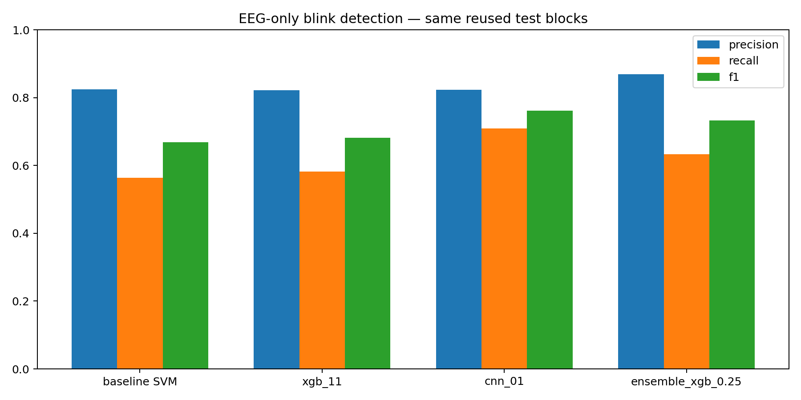

# CNN and XGBoost on the two real Rana recordings

Validation-selected winner: **ensemble_xgb_0.25**.

Twelve XGBoost hyperparameter configurations; four CNN configurations each trained with two seeds (eight CNN runs). CNN seeds are averaged per configuration rather than selecting a lucky seed. Three averaging weights combine the two validation-selected family models. No public data or pretrained weights were used.

XGBoost uses the same 58 EEG features as the baseline. CNN receives the saved 192-point, low-pass-filtered waveform per 1.5-second window as two channels: training-scale normalization and within-window normalization. Three convolution blocks retain coarse position with adaptive pooling and a small classification head. Training uses AdamW and binary cross entropy; epoch selection uses validation average precision with early stopping.

All models use the existing 60/20/20 time-block split and original selected training rows. Normalization is fitted on training only. XGBoost tree count and CNN epoch count use validation only. Detection thresholds and ensemble weights maximize validation event F1. Test predictions are produced after frozen_selection.json is written. Saved weights were reloaded and reproduced test scores.

| Model | Validation event F1 | Test window accuracy | Event precision | Event recall | Event F1 | False alarms/min |
|---|---:|---:|---:|---:|---:|---:|
| baseline SVM | 84.5% | 77.2% | 82.4% | 56.3% | 66.9% | 5.45 |
| xgb_11 | 84.8% | 76.6% | 82.1% | 58.2% | 68.1% | 5.74 |
| cnn_01 | 86.2% | 81.4% | 82.4% | 70.9% | 76.2% | 6.89 |
| ensemble_xgb_0.25 | 86.5% | 79.2% | 87.0% | 63.3% | 73.3% | 4.30 |

## Limits

These test blocks were already inspected in earlier experiments: this is a reused-test development comparison, not an untouched confirmatory estimate. Automatic webcam labels remain unreviewed. Synchronization is the unchanged provisional host-clock map; no blink-delay correction was introduced. Sustained closures and invalid tracking are excluded from scoring. Clipping is retained and flagged. Only same-person time-block generalization is assessed. Centered windows require 750ms lookahead; this is not yet a validated real-time detector.

## Reproduce

`src/model/Run_Rana_CNN_XGB.command` on macOS (uses the PyTorch-bundled OpenMP library), or `python src/model/train_rana_cnn_xgb.py` elsewhere, after generating `data/model/rana_new` with `train_rana_new.py`. Requirements are in `src/model/requirements-rana-cnn-xgb.txt`. Model files, validation searches, training histories, scores, and frozen decisions are in this folder. Raw files and baseline results are unchanged; nothing was pushed.

