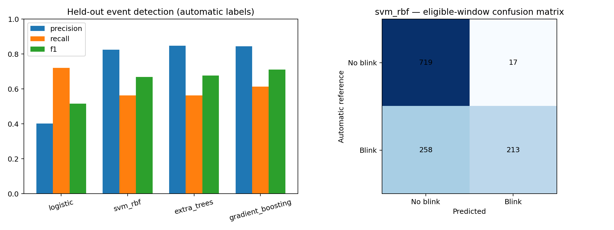
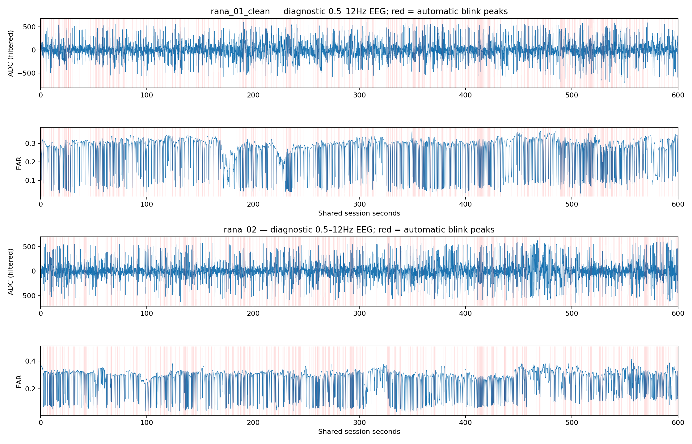

# New Rana recordings: training pilot

Selected using validation only: **svm_rbf**.

Only `rana_01_clean` and `rana_02` recorded on November 16, 2026 are included. All older and public recordings are excluded, without deleting them. Raw source files remain unchanged.

## Split and task

Each recording: training 0–120, 180–240, 300–420, 480–540 seconds; validation 120–180 and 420–480; test 240–300 and 540–600. Nominal 60/20/20; two-second guards plus half-window margins remove boundaries. Early and late are time ranges, not verified activity classes.

Input: EEG A4 only, 1,000Hz ADC; independent causal filters per minute (0.5–12Hz and 0.5–30Hz with 50Hz notch), 1.5-second context every 100ms. Shape/amplitude/slope features. No EAR, timestamps, session identity, protocol or label metadata enters the model. Training keeps up to three negatives per positive. Validation/test retain their natural usable prevalence.

Target: a blink peak within 150ms of the window center. Ambiguous near-blink windows are excluded from window classification metrics, but included in continuous event scoring. Sustained closures, incomplete labels and tracking-invalid centers are excluded. Clipped EEG windows are retained and flagged, so movement-related difficulty is not silently discarded. Event scoring uses nonmaximum suppression and one-to-one matching within 250ms.

## Results

| Model | Window accuracy | Event precision | Event recall | Event F1 | False alarms/min |
|---|---:|---:|---:|---:|---:|
| logistic | 62.4% | 40.1% | 72.2% | 51.6% | 48.78 |
| svm_rbf | 77.2% | 82.4% | 56.3% | 66.9% | 5.45 |
| extra_trees | 78.0% | 84.8% | 56.3% | 67.7% | 4.59 |
| gradient_boosting | 77.6% | 84.3% | 61.4% | 71.1% | 5.16 |

Accuracy counts correct eligible windows; event precision is how many detections match automatic labels; recall is how many labeled blinks are detected. F1 balances precision and recall. Window accuracy is easier than continuous detection and must not be presented as event accuracy.

## Limitations

- Same-person held-out time blocks, not unseen people or sessions.
- Automatic webcam labels are proxy truth; errors are unreviewed.
- Clock alignment is provisional; one millisecond sample spacing is not synchronization accuracy.
- Scripted protocol was not followed; no condition-specific labels inferred.
- Sustained closures and tracking-invalid intervals are excluded; no separate closure classifier trained.
- No test-driven model selection. Test reused across predeclared models only for descriptive reporting.
- Centered 1.5-second windows require 750ms lookahead; not a validated live detector.

The original session state says partial because Windows failed decoding the review HTML template. Both raw recordings span about 600 seconds. This pipeline does not overwrite that provenance, trusts actual raw counts, and reads the already-written automatic event boundaries by frame index. The recorder template now explicitly uses UTF-8.

Clock diagnostics and extrema matching are in `data_quality_and_alignment.json` and each session’s `alignment_checks.csv`. Extrema coincidence is not proof of correct labeling; dense EEG extrema can match by chance. No blink-derived shift was fitted to the test data.

Reproduce: `python3 src/model/train_rana_new.py` from the repo, using dependencies in `src/model/requirements-rana-new.txt`. Run `python3 src/model/check_rana_new.py` to verify split isolation and saved-model reproducibility. Model artifacts are offline pilot models, not a final retrained deployment model.

Validation practices: https://scikit-learn.org/stable/common_pitfalls.html and https://scikit-learn.org/stable/modules/cross_validation.html

## Interpretation and next step

The SVM was selected before evaluating test results. It detected 89 of 158 evaluable test blinks, missed 69, and raised 19 false alarms over 3.485 evaluable minutes. Its event F1 fell from 84.5% on validation to 66.9% on test. Gradient boosting had the highest descriptive test F1 (71.1%), but choosing it now would use the test set for selection. Further tuning needs a fresh held-out recording.

The no-blink-only baseline scores 61.0% on eligible test windows. There are 1,207 eligible classification windows, and overlapping windows are not independent examples. Train has 1,379 positive and 2,311 negative selected windows (about 1.68 negatives per positive; fewer than the cap of three because only eligible negatives are used). Neither window count is a count of unique blinks.

Held-out clock checks: 71/78 and 90/101 automatic blink peaks lie within 150 ms of the selected EEG extrema for session 1 and session 2, respectively. Median absolute differences are 65.9 and 62.3 ms. Matching EEG extrema was diagnostic only; no test-based timing correction was fitted. These values include ambiguous or unusable event candidates, unlike the model evaluation counts.

All source files and trained artifacts remain local; nothing was committed or pushed.
