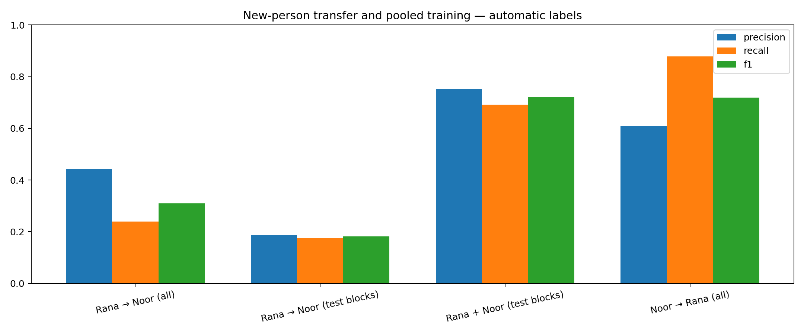

# Adding Noor4 to the real-data CNN

Only `rana_01_clean`, `rana_02`, and the new `noor4-clean` recording are used. Raw data and earlier results are preserved.

Architecture is the previously chosen 1D CNN (width 16, dropout 0.2, learning rate 0.001), averaged across two seeds. Pooled and Noor-only models are trained afresh with early stopping on their source validation data. The same purged 60/20/20 minute split is retained. Training uses up to three eligible negatives per positive separately per session. Validation chooses epochs and threshold; the configuration is not searched again.

| Experiment | Window accuracy | Event precision | Event recall | Event F1 | False alarms/min |
|---|---:|---:|---:|---:|---:|
| frozen_Rana_to_Noor_all | 91.7% | 44.3% | 23.9% | 31.0% | 4.26 |
| frozen_Rana_to_Noor_test_blocks | 91.9% | 18.8% | 17.6% | 18.2% | 8.49 |
| pooled_Rana_Noor_test_blocks | 86.1% | 75.2% | 69.1% | 72.0% | 7.97 |
| Noor_to_Rana_all | 79.6% | 60.9% | 87.9% | 72.0% | 23.69 |

## Pooled model per person

| Person | Precision | Recall | F1 |
|---|---:|---:|---:|
| Noor | 25.0% | 29.4% | 27.0% |
| Rana | 82.3% | 73.4% | 77.6% |

## Interpretation

Frozen Rana→Noor is the strongest unseen-person check here: no Noor blinks trained that model or selected its threshold. Compare its test-block subset to the pooled Noor test-block result to assess adaptation on the same interval. The pooled result is a familiar-person held-out-time result, NOT evidence of generalization to a third person. Noor→Rana is exploratory because earlier architecture development already used Rana. Different full-recording and test-block rows cover different events and should not be directly ranked.

No source protocol activity labels are treated as true conditions. See `reports/noor4_preparation/data_quality_and_alignment.json` for clock/signal checks. The Windows partial-state export error is preserved in source metadata; actual sample and frame data are processed.

Existing live detector weights are unchanged. New weights and frozen threshold files are in this report folder.

Reproduce with the training environment and bundled Torch OpenMP library: `src/model/Run_Noor4_Training.command`.

## Direct before/after on identical test blocks

On Noor: the frozen Rana model caught 3/17 blinks with 13 false alarms (18.2% F1). After pooled training, it caught 5/17 with 15 false alarms (27.0% F1). This is a small improvement on a very small test sample and remains poor. On Rana: the earlier CNN caught 112/158 with 24 false alarms (76.2% F1); the pooled model caught 116/158 with 25 false alarms (77.6% F1).

Overall pooled window accuracy is 86.1%, but it conceals poor Noor recall; event scores per person are more informative. There are 3,690 selected Rana training windows and 720 Noor windows, so the pooled fit is dominated by Rana. These are overlapping windows, not independent blinks.

Noor raw QC: 600,009 contiguous EEG samples, 130 automatic blink labels, 18 sustained closures, approximately 0.96% lower-rail samples, batch timing residual p95 approximately 40.7ms. Mapping remains provisional.
