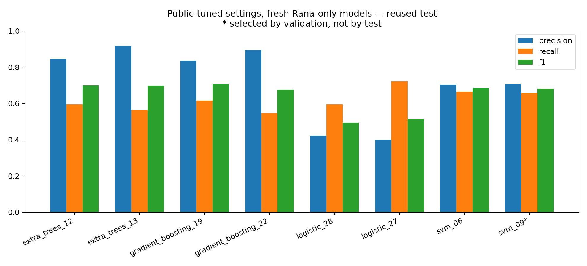

# Public-data hyperparameters → fresh Rana-only training

Validation-selected model: **svm_09**.

29 configurations across SVM, extra trees, gradient boosting and logistic regression were compared using three public time-block folds (87 public fits). The top two per family were instantiated afresh and fitted only on the existing real Rana training split (8 fresh fits). Validation event F1 selected thresholds and the final model. Public trained weights were not transferred.

Public source: EEGEyeNet EP10, OpenNeuro ds007338 v1.0.0, https://openneuro.org/datasets/ds007338/versions/1.0.0 . The historical folder alias `rana1` is an external public import, NOT a recording of Rana. EEG E22 originally 500Hz, resampled to 1000Hz and mapped to ADC in the prior import. Target times here are independent eye-tracker blink interval midpoints, not EEG-derived peaks.

The public set has only 68 blink annotations from one recording, so the search provides limited evidence about transferable settings. “Best” means best among this explicit search, not a global optimum.

## Frozen selection

```json
{
  "hyperparameters": {
    "C": 100,
    "gamma": 0.003
  },
  "threshold": 0.65
}
```

## Reused-test comparison

| Configuration | Public CV AP | Validation event F1 | Test window accuracy | Event precision | Event recall | Event F1 |
|---|---:|---:|---:|---:|---:|---:|
| extra_trees_12 | 84.3% | 80.5% | 78.6% | 84.7% | 59.5% | 69.9% |
| extra_trees_13 | 84.2% | 81.5% | 76.8% | 91.8% | 56.3% | 69.8% |
| gradient_boosting_19 | 88.3% | 80.0% | 77.1% | 83.6% | 61.4% | 70.8% |
| gradient_boosting_22 | 87.6% | 81.7% | 74.8% | 89.6% | 54.4% | 67.7% |
| logistic_28 | 80.1% | 49.1% | 65.3% | 42.2% | 59.5% | 49.3% |
| logistic_27 | 78.3% | 47.8% | 62.4% | 40.1% | 72.2% | 51.6% |
| svm_06 | 94.1% | 83.3% | 79.5% | 70.5% | 66.5% | 68.4% |
| svm_09 | 93.4% | 85.3% | 77.7% | 70.7% | 65.8% | 68.2% |

## Interpretation

The model settings and thresholds were frozen before this run evaluated test predictions. However, these same test blocks were already viewed during the baseline experiment, so this is not an untouched confirmatory test. Do not choose a different winner by inspecting this test table. A new recording is needed for a fresh final evaluation.

The 60/20/20 time-block split, automatic labels, guard gaps, causal filtering, features, 350ms suppression, 250ms event matching and provisional host-clock synchronization are unchanged from the baseline. All final models use only real Rana recordings. The 1.5-second centered window requires 750ms lookahead. Classifier inputs are EEG-only; face-validity and closure exclusions limit the evaluated intervals.

No additional synchronization correction was applied in this experiment. The known uncertainty in labels and timing remains. Sustained closures are excluded rather than silently converted to no-blink.

No guarantee of improvement: compare the validation-selected model to the original SVM, not whichever test row looks best. Baseline SVM: event precision 82.4%, recall 56.3%, F1 66.9%, window accuracy 77.2%.

## Reproduce

`python3 src/model/tune_public_transfer.py` after `python3 src/model/train_rana_new.py`; dependencies: `src/model/requirements-rana-new.txt`. All outputs remain local.


